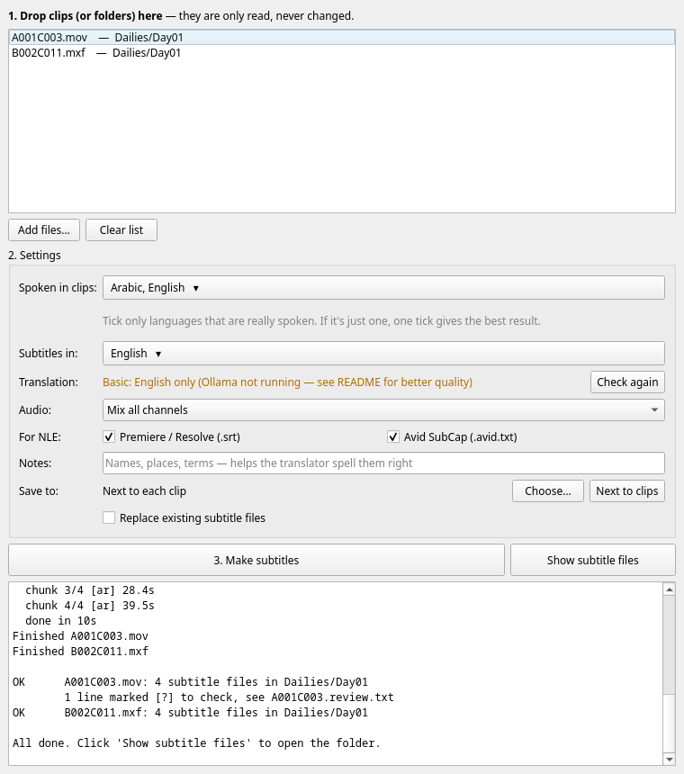
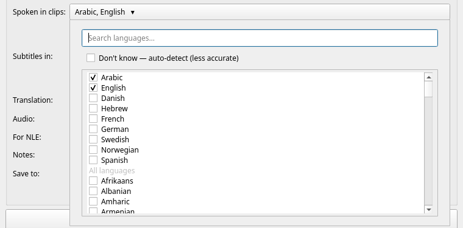

# MakeSubs

Subtitle sidecar files for on-set dailies, made entirely on your own machine.

Drop in clips, get `.srt` (Premiere Pro, DaVinci Resolve) and/or Avid SubCap files next to
them: a transcript in the spoken language plus translations (English by default, Danish and
other languages optional). **Source clips are only read, never modified**: no remuxing,
no embedded tracks, so timecode, reel names and all other metadata stay exactly as they were.

- Speech recognition: Whisper large-v3 (NVIDIA GPU via faster-whisper, Apple Silicon via MLX)
- Translation: a local LLM through [Ollama](https://ollama.com) (optional, recommended), or
  Whisper's built-in English translation
- Frame-accurate cues using the clip's frame rate (including 29.97/59.94 drop-frame) and
  source timecode
- Lines the recogniser was unsure about are marked `[?]` and listed in a review file

## Install (editors)

You need about 15 GB of free disk space, an internet connection for the first setup, and
either a Windows PC with an NVIDIA graphics card or a Mac with Apple Silicon (M1 or later).
Other machines work too, just much slower.

**Windows**: open PowerShell and paste:

```powershell
powershell -ExecutionPolicy ByPass -c "irm https://raw.githubusercontent.com/Wangle-Media/make-english-subs/main/install/install-windows.ps1 | iex"
```

**Mac**: open Terminal and paste:

```bash
curl -fsSL https://raw.githubusercontent.com/Wangle-Media/make-english-subs/main/install/install-mac.sh | bash
```

The installer asks whether to add the **high-quality translator** (Ollama plus an about 8 GB
model). Say yes unless disk space is tight: it gives clearly better English, and it is required
for Danish and other target languages. You can run the installer again at any time to update
or to add the translator later.

The installer also runs a short test of the speech recognition. If it says
**WARNING: no usable NVIDIA GPU** on a PC that has an NVIDIA card, update the graphics driver
from [nvidia.com](https://www.nvidia.com/Download/index.aspx) and run the installer again;
otherwise MakeSubs runs on the CPU, which is very slow. If the installer stops with an error,
copy the text in the window and send it to whoever set up MakeSubs for you.

When it finishes you have a **MakeSubs** shortcut on the desktop (Windows) or in
`~/Applications` (Mac).

### Uninstall

**Windows** (PowerShell) / **Mac** (Terminal):

```
uv tool uninstall makesubs
```

Then delete the shortcut, and to free the disk space used by the speech model, the folder
`.cache\huggingface` in your user folder (Windows; also `C:\ProgramData\MakeSubs` if it
exists) or `~/.cache/huggingface` (Mac). Remove **Ollama** like any other app if you
installed the translator and don't need it for anything else.

## Using it

Open **MakeSubs** from the desktop shortcut (Windows) or `~/Applications` (Mac). The window
has three numbered steps, from top to bottom.



### 1. Add clips

Drag clips, or whole folders of clips, onto the list at the top. You can also click
**Add files…**. The clips are only read, never changed. **Clear list** empties the list
(it doesn't touch any files).

### 2. Settings

**Spoken in clips**: click the button and tick the language(s) people actually speak.
Type in the search box to find a language quickly; clicking its name ticks it.



**Setting the language gives better results than auto-detect.** If only one language is
spoken, tick just that one. Tick *Don't know — auto-detect* only when you really don't know.

**Subtitles in**: tick English, Danish or any other language, the same way.

**Translation** shows which translator will be used:

- Green *Local LLM ready*: the high-quality translator is running. Any subtitle language works.
- Orange *Basic: English only*: only English subtitles, in lower quality. If you installed the
  high-quality translator, start the **Ollama** app and click **Check again**.

**Audio**: *Mix all channels* is fine for camera scratch audio. If one channel is clearly
better (e.g. a boom on channel 1), pick it.

**For NLE**: *Premiere / Resolve (.srt)*, *Avid SubCap*, or both.

**Notes**: names of characters, places and special terms, e.g.
`Characters: Nidal, Yasmin. Places: Jenin, Nablus.` This helps the translator spell them right.

**Save to**: *Next to each clip* by default. Click **Choose…** to put all subtitle files in one
folder instead, and **Next to clips** to go back.

**Replace existing subtitle files**: leave this off to skip clips that already have subtitles,
so a second run doesn't overwrite files you've already checked. Tick it to make them again.

MakeSubs remembers these settings for next time.

### 3. Make subtitles

Click **Make subtitles**. The box underneath shows what's happening. The first run downloads
the models (several GB) and takes longer; after that, expect roughly a minute per few minutes
of footage on a recent NVIDIA card or M-series Mac, plus about 30–90 s per clip and language
for high-quality translation. Wait for it to finish before closing the window.

When it's done, the box ends with a summary per clip:

```
OK      A001C003.mov: 4 subtitle files in D:\Dailies\Day01
        1 line marked [?] to check, see A001C003.review.txt
OK      B002C011.mxf: 4 subtitle files in D:\Dailies\Day01

All done. Click 'Show subtitle files' to open the folder.
```

Click **Show subtitle files** to open that folder. Then import the files into your NLE (see
[Importing into the NLE](#importing-into-the-nle)), and have the lines marked `[?]` checked.

### If something goes wrong

| Message in the box | What to do |
|---|---|
| `SKIP …: subtitles already exist` | That clip was done before. Tick *Replace existing subtitle files* to make them again. |
| `SKIP …: no audio` | The file has no sound (or isn't a video). Use a version of the clip with audio. |
| `… needs the high-quality translator (Ollama)` (orange, under *Subtitles in*) | Start the Ollama app and click **Check again**, or untick the non-English languages. |
| `FAILED …` | Something went wrong with that clip; the reason is on the same line. The other clips still finish. |
| A box saying *MakeSubs: unexpected error* | Send the file it names (`makesubs.log`) to whoever set up MakeSubs for you. |

The log file is in `%LOCALAPPDATA%\Wangle Media\MakeSubs` (Windows) or
`~/Library/Application Support/Wangle Media/MakeSubs` (Mac).

### What you get

For `A001C003.mov`, next to the clip (or in the folder you chose):

| File | Contents |
|---|---|
| `A001C003.transcript.srt` | What was said, in the original language(s) |
| `A001C003.en.srt`, `A001C003.da.srt`, ... | Translations |
| `*.avid.txt` | The same, as Avid SubCap files (if selected) |
| `A001C003.review.txt` | Languages detected, and every line that needs checking, with source timecode |

Existing subtitle files are never replaced unless you tick *Replace existing subtitle files*.

### Lines marked `[?]`

Machine transcription of scratch audio makes mistakes, and the dangerous ones **read
fluently**. When the recogniser's confidence is low (noise, off-mic, overlapping dialogue),
the line is marked `[?]` in every language and listed in `review.txt`. Have an Arabic speaker
check those lines before anything goes to a client or into a cut that depends on them.

### Importing into the NLE

- **Premiere Pro**: *File → Import* the `.srt`, then drag it onto the sequence above the clip.
  SRT times start at the first frame of the clip, so line it up with the clip's start.
- **DaVinci Resolve**: *File → Import → Subtitle...*, then drag the subtitle from the media
  pool onto the timeline, aligned with the clip's start.
- **Avid Media Composer**: add the SubCap effect to a subtitle track, then
  *Effect Editor → Caption Files → Import Caption Data*. SubCap timecodes must match the
  **sequence** timecode; MakeSubs uses the clip's source timecode, so this works directly
  when the clip is edited into a sequence at its own source TC. Otherwise use
  `--avid-start` (command line) to set the sequence start.

> These import steps have been checked against the file formats, not yet in each NLE with
> real project media. Please report anything that doesn't line up.

## Command line

The installer also adds a `makesubs` command, which does the same as the window and is handy
for batches and scripts. Open a **new** Terminal/PowerShell window after installing so the
command is found.

```
makesubs [options] CLIP [CLIP ...]
```

With no options it uses the same defaults as the window: Arabic + English spoken, English
subtitles, `.srt`, all audio channels mixed, files written next to each clip.

### Examples

```bash
# English subtitles for one clip
makesubs A001C003.mov

# English and Danish, for Premiere/Resolve and Avid
makesubs A001C003.mov B002C011.mxf --to en,da --format srt,avid

# Only Arabic is spoken: say so, it gives better results
makesubs A001C003.mov --spoken ar

# Check timecode, frame rate and audio channels before choosing one
makesubs --info A001C003.mov

# Use only channel 1 (e.g. the boom) and write the files into another folder
makesubs A001C003.mov --channel 1 --out ~/Desktop/subs

# Help the translator spell names and places
makesubs A001C003.mov --to en,da --note "Characters: Nidal, Yasmin. Places: Jenin, Nablus."
```

A whole day's clips (MakeSubs takes files, not folders, on the command line):

```bash
# Mac
makesubs /Volumes/Dailies/Day01/*.mov --to en,da
```

```powershell
# Windows (PowerShell)
makesubs (Get-ChildItem D:\Dailies\Day01\*.mov).FullName --to en,da
```

### Example output

Real output from a 29.97 drop-frame test clip with two mono audio tracks and Syrian Arabic
speech.

`makesubs --info B002C011.mxf` shows what MakeSubs reads from the clip:

```
B002C011.mxf: 54.0s, 29.970 DF, TC 09:59:58;00, a0:1ch, a1:1ch
  reel: -; channels: 1 (stream 1, ch 1), 2 (stream 2, ch 1)
```

`makesubs B002C011.mxf --to en,da --format srt,avid` writes these files next to the clip:

```
B002C011.transcript.srt        B002C011.transcript.avid.txt
B002C011.en.srt                B002C011.en.avid.txt
B002C011.da.srt                B002C011.da.avid.txt
B002C011.review.txt
```

`B002C011.transcript.srt` contains what was said, in the spoken language. Times start at the
clip's first frame:

```
1
00:00:00,601 --> 00:00:03,971
مرحبا أنا اسمي دال وأنا من سوريا أعيش
```

`B002C011.en.srt`:

```
1
00:00:00,601 --> 00:00:03,971
Hello, my name is Nidal
and I'm from Syria. I live
```

`B002C011.da.avid.txt` is the same subtitle for Avid, on the clip's source timecode:

```
@ makesubs

<begin subtitles>

09:59:58;18 10:00:01;29
Hej, mit navn er Nidal,
og jeg er fra Syrien.
```

`review.txt` from a different clip, where one line was hard to hear:

```
Clip:        A001C003.mov
Source TC:   14:23:11:05   fps: 23.976
Languages:   en, ar
Translation: local LLM (gemma3:12b)
Subtitles:   13, of which 1 need review ([?] in the files)
...
14:24:20:02  (50%)  وانتهى الامر
```

The timecode on each review line takes you straight to the spot in the source clip.

### Options

| Option | Default | What it does |
|---|---|---|
| `-t`, `--to LANGS` | `en` | Subtitle languages, comma-separated: `en`, `en,da`, `en,da,de`. Anything other than `en` needs the high-quality translator. |
| `-s`, `--spoken LANGS` | `ar,en` | Languages spoken in the clips, or `auto`. Name the real ones: it beats `auto`, and a single language (e.g. `ar`) is most robust when nobody switches. |
| `-f`, `--format LIST` | `srt` | `srt` (Premiere/Resolve), `avid` (SubCap), or `srt,avid`. |
| `-c`, `--channel N` | `mix` | `mix` averages all audio, or a channel number as listed by `--info`. |
| `-o`, `--out FOLDER` | next to clip | Write subtitle files into this folder (created if missing). |
| `--note TEXT` | | Names, places and terms for the translator. |
| `--avid-start TC` | clip source TC | Sequence start timecode for SubCap files, e.g. `01:00:00:00`. |
| `--overwrite` | off | Replace existing subtitle files (otherwise those clips are skipped). |
| `--info` | | Only show each clip's timecode, frame rate, reel and audio channels. |
| `--setup` | | Download the models now, then exit (the installer does this). |
| `--version` | | Show the installed version. |

Less common options:

| Option | Default | What it does |
|---|---|---|
| `--translator` | `auto` | `llm` (Ollama, any language), `whisper` (built-in, English only), or `auto` (`llm` when Ollama is running). |
| `--llm-model NAME` | `gemma3:12b` | Ollama model used for translation. |
| `--threshold N` | `0.6` | Confidence (0–1) below which a line is marked `[?]`. Higher marks more lines. |
| `--no-marks` | off | Leave `[?]` out of the subtitle text; flagged lines are still listed in `review.txt`. |
| `--backend` | `auto` | Force `faster-whisper` (NVIDIA/CPU) or `mlx` (Apple Silicon). |
| `--whisper-model NAME` | large-v3 | Different speech model for a quick test on a slow machine: `medium` on Windows, `mlx-community/whisper-medium-mlx` on a Mac. Expect worse Arabic. |

Language codes are the usual two-letter codes: `ar` Arabic, `en` English, `da` Danish,
`de` German, `fr` French, `sv` Swedish, `no` Norwegian, `he` Hebrew, and so on.

When it finishes, `makesubs` lists every file it wrote per clip. It exits with status 0 when
all clips succeeded and 1 if any failed, so it can be used in scripts.

## Known limitations

- **Dialect and scratch audio**: tested on Levantine Arabic (Palestinian, Syrian, Lebanese)
  samples. Clean speech is transcribed well, including dialect. Heavily noisy or distant audio
  can produce invented text; that is what the `[?]` marks are for. Validate on real camera-test
  footage before principal photography.
- **Language switches inside a sentence**: language is detected per stretch of speech (up to
  about 15 s), so a short phrase in a second language right next to the first may be written
  in the wrong language.
- **Camera-original raw formats** (BRAW, R3D, ARRIRAW) aren't supported; use the transcodes.
  Avid OP-Atom MXF stores audio in separate files: point MakeSubs at the audio MXF.

## Development

```bash
uv sync
uv run pytest
uv run makesubs-gui
```

Code lives in `src/makesubs/`: `probe` (metadata), `audio` (decoding), `asr` (Whisper, voice
activity detection, language detection), `shape` (cue timing and line breaks), `translate`
(Ollama), `writers` (SRT and SubCap), `pipeline`, `cli`, `gui`.
